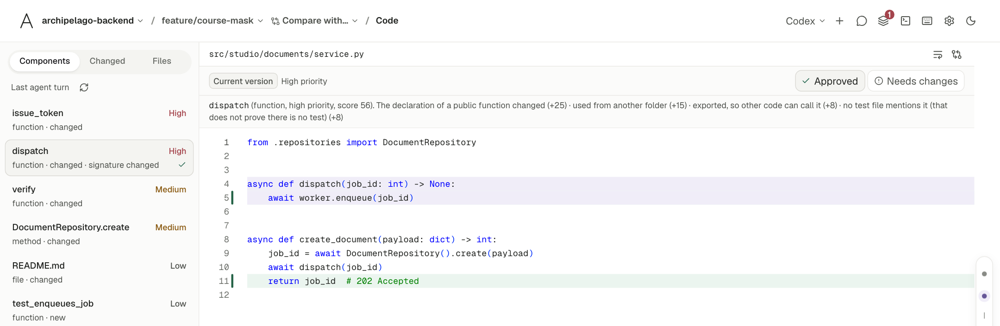
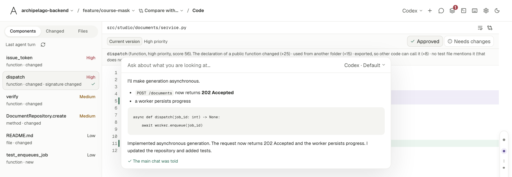
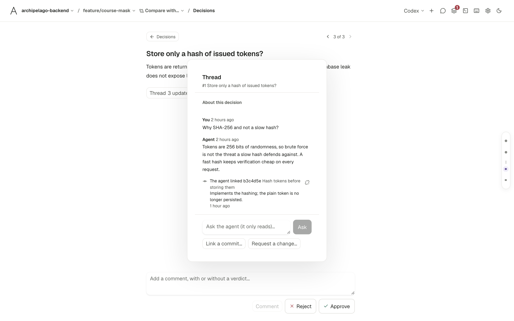
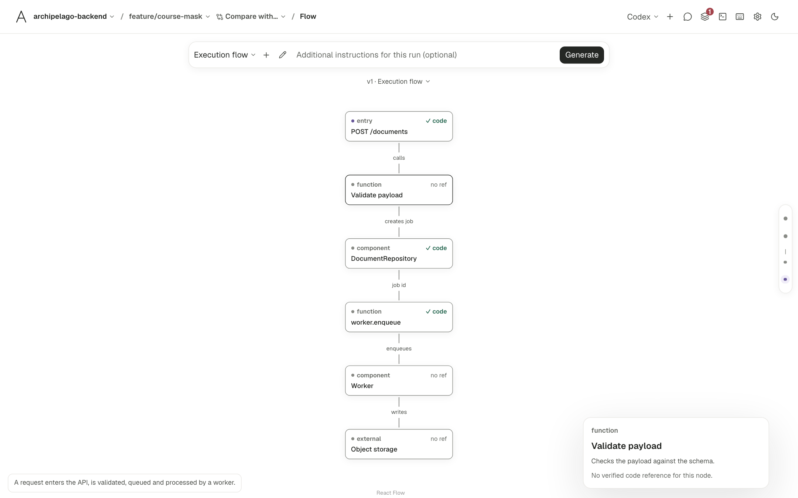
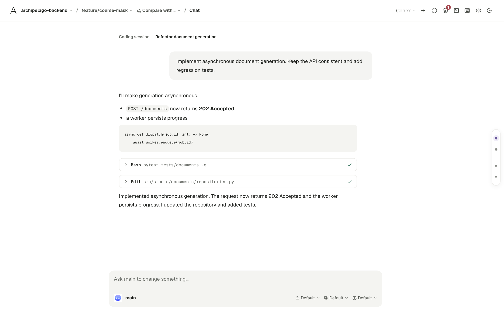
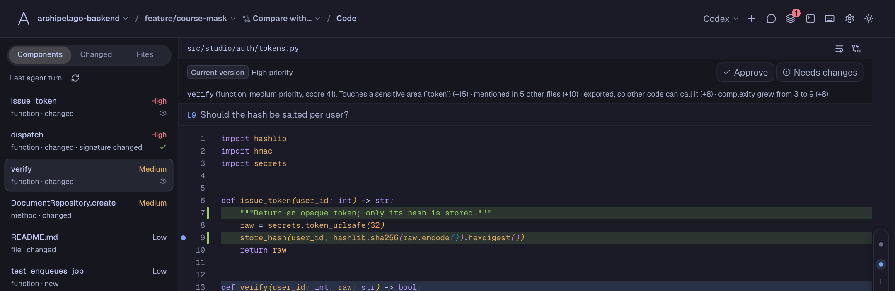
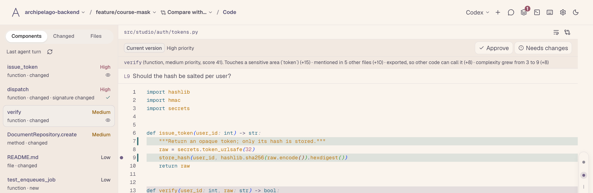
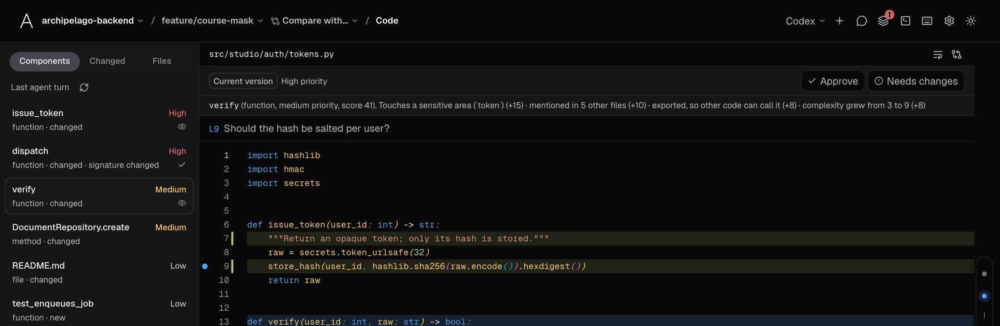
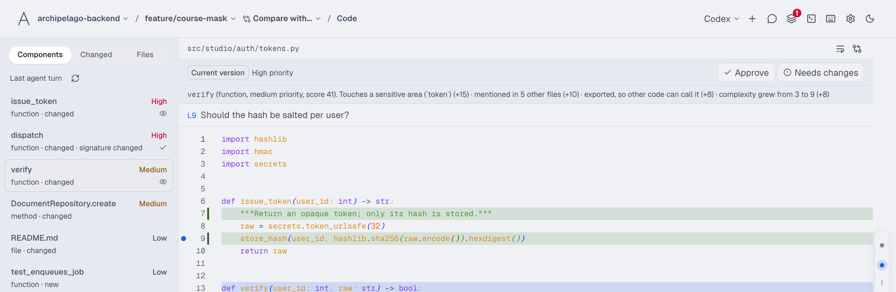

# Ataraxia

Review what your coding agents wrote, one component at a time.

Ataraxia is a desktop app where you chat with Claude Code, Codex or OpenCode, and then read the result
ranked by what needs your eyes first. It puts the chat, the code review, the decisions behind the change
and a diagram of how it fits together in one window, and you move between them from the keyboard.

<picture>
  <source media="(prefers-color-scheme: dark)" srcset="docs/images/code-dark.png">
  
</picture>

<sub>Every screenshot here is the app in its preview mode, with sample data.</sub>

## Quickstart

1. Install it.

   ```bash
   brew install --cask myrk-kale/tap/ataraxia   # macOS: the app, in Applications
   brew install myrk-kale/tap/ataraxia          # Linux (and the command line on macOS)
   ```

   On Windows, run the `-setup.exe` from the [latest release](https://github.com/myrk-kale/ataraxia/releases/latest).
   On Linux you can also use the `.deb`, `.rpm` or `.AppImage` there. [All the ways to install](#install).

2. Have a coding agent installed: Claude Code, Codex or OpenCode. Ataraxia finds it on your `PATH`.

3. Run `ataraxia`, open a repository from the header, and ask the agent for a change. When its turn ends,
   open Code: the files it touched are there, with the components that changed at the top of the list.

To run it from the source instead:

```bash
git clone https://github.com/myrk-kale/ataraxia.git && cd ataraxia
pnpm install && pnpm tauri dev
```

You need Node 22, pnpm, Rust and your system's Tauri libraries; [the list per system is below](#run-it-from-the-source-code).

## Read the components that matter first

A long diff reads in file order, so a rename sits next to a change in how tokens are checked. Ataraxia
lists the functions, methods, classes and types that changed, and ranks each one High, Medium or Low.

The rank comes from the syntax tree and from git: how many other files use the component, whether its
signature changed, how much of it changed, whether it touches something sensitive such as a token or a
database, and whether any test file mentions it. Open a component and the reasons are written above the
code, each with the points it added, for example "the declaration of a public function changed (+25)".
Nothing is sent to a model to work this out; it runs on your machine.

From there you mark a component approved or ask for changes, comment on a line, edit the file in the
built-in editor, and press `Alt+V` to see the file as it was before the agent touched it. The ranking
understands Rust, TypeScript, JavaScript, Python, Go and Java. Any other file appears as one component.

## Ask a question without leaving what you are reading

`Ctrl/Cmd+K` opens a bar from any screen. Ask about the component, file, decision or diagram you have
open, and a read-only session answers on the model you choose, which starts as the one your chat is on.
It never edits your files. It also appears among the chat's subagents, and when it finishes the main
agent is told what you asked.

<picture>
  <source media="(prefers-color-scheme: dark)" srcset="docs/images/btw-dark.png">
  
</picture>

## Keep the choices that deserve a verdict

Some changes carry a choice a reviewer should accept or reject on purpose: how tokens are stored, what an
endpoint now returns. Ataraxia keeps each one as a thread, the way an issue works. A decision holds its
description, a discussion you can have with a read-only agent, your verdicts, and the commits that
influence it. It stays where it is while the code changes, and you say which commits belong to it.

<picture>
  <source media="(prefers-color-scheme: dark)" srcset="docs/images/decisions-dark.png">
  
</picture>

Decisions are never generated behind your back. After a review or a piece of work, the agent asks whether
you want them, and writes them only if you say yes.

## See how it fits together

Flow draws a diagram of how a request or an action moves through the code. Each node points at a file that
exists, and a node that cannot be tied to the code is marked, so a diagram cannot quietly invent a module.
When the code moves on, the diagram says it is out of date.

<picture>
  <source media="(prefers-color-scheme: dark)" srcset="docs/images/flow-dark.png">
  
</picture>

## Use the agent you like, and change your mind

Claude Code, Codex and OpenCode run behind the same chat, with streaming, tool cards, permission
prompts, cancel, and subagents you can open and write to. Switching the provider in the middle of a chat
keeps the conversation on screen, writes it to a text file, and tells the new agent where that file is,
so it can read what was said before.

<picture>
  <source media="(prefers-color-scheme: dark)" srcset="docs/images/chat-dark.png">
  
</picture>

Every agent is also told what Ataraxia is. It reads its guide to decisions, flows and review comments only
after you agree to them.

## Make it yours

There are eleven themes, each with a light and a dark variant, and you can import any VS Code colour theme
from its `.json` file. The typeface and size are set separately for the interface, the chat, the code and
the terminal. Settings has the rest, including a switch for the few sounds the app makes.

<table>
  <tr>
    <td></td>
    <td></td>
  </tr>
  <tr>
    <td></td>
    <td></td>
  </tr>
</table>

Everything has a shortcut: `Shift+↑/↓` changes screen, `` Ctrl/Cmd+` `` opens a terminal in the current worktree,
`J` and `K` step through the queue, `C` comments, and `?` lists them all.

## What stays on your machine

The ranking is computed locally, and your repository is read from disk. Nothing goes to a model on its own:
decisions, diagrams and BTW questions run only when you start them, with the provider you pick, and that
provider then receives the diff. The agents are the command-line tools you already have, signed in the way
you already signed them in. The conversations and the review are kept in a local database. Each release is
built by GitHub Actions and carries a build attestation you can check with `gh attestation verify`.

## Install

Every release is on the [releases page](https://github.com/myrk-kale/ataraxia/releases). Each file has a
`.sha256` beside it and a build attestation: `gh attestation verify <file> --repo myrk-kale/ataraxia`.
They are built by the release pipeline, never by hand.

**macOS** (Apple silicon and Intel, macOS 11 or newer; there is no installer, it comes through Homebrew)

```bash
brew install --cask myrk-kale/tap/ataraxia   # Ataraxia.app, in Applications and in Launchpad
brew install myrk-kale/tap/ataraxia          # or only the `ataraxia` binary, with `ataraxia mcp` for agents
```

The app is not signed with an Apple Developer ID. The cask removes the quarantine mark from it, which is
what lets it open on the first try; the rest of the app is the one this repository builds.

**Linux** (`x86_64` and `aarch64`; built on Ubuntu 22.04, so it runs on Ubuntu 22.04 and newer, Debian 12,
Fedora 36 and newer, Arch and the like)

```bash
brew install myrk-kale/tap/ataraxia                      # Homebrew on Linux
sudo apt install ./ataraxia-v0.1.0-x86_64-unknown-linux-gnu.deb   # Debian, Ubuntu
sudo dnf install ./ataraxia-v0.1.0-x86_64-unknown-linux-gnu.rpm   # Fedora, openSUSE
chmod +x ataraxia-v0.1.0-x86_64-unknown-linux-gnu.AppImage && ./ataraxia-v0.1.0-x86_64-unknown-linux-gnu.AppImage
```

The `.tar.gz` holds the bare binary. Whatever the route, the window needs GTK 3 and WebKitGTK 4.1 from
the distribution (`sudo apt install libwebkit2gtk-4.1-0 libgtk-3-0`, or `sudo dnf install webkit2gtk4.1
gtk3`); the `.deb` and `.rpm` ask for them by themselves.

**Windows** (x64): run `ataraxia-v0.1.0-x86_64-pc-windows-msvc-setup.exe` (for you, or for every user),
or use the `.msi` for managed installs. The installer is not signed, so SmartScreen shows "More info
> Run anyway". WebView2 is installed along with it when the machine lacks it.

**With Cargo** (the crate is `ataraxia-ide`; the binary it installs is `ataraxia`)

```bash
cargo binstall ataraxia-ide                                  # the prebuilt binary of this release
cargo install ataraxia-ide --locked --features custom-protocol   # or build it (needs the system libraries below)
```

You also need a coding agent: Claude Code, Codex or OpenCode. With none installed, the app says what to install.

## Run it from the source code

Prerequisites:

- Node.js 22+ and pnpm 11+ (`corepack enable` gives you pnpm)
- Rust 1.85+ (`cargo` / `rustc` on `PATH`; Homebrew Rust works if rustup cannot reach `static.rust-lang.org`)
- The Tauri system libraries for your OS:
  - **macOS:** `xcode-select --install`
  - **Debian, Ubuntu:** `sudo apt install build-essential curl wget file patchelf pkg-config libxdo-dev libssl-dev libgtk-3-dev libwebkit2gtk-4.1-dev libayatana-appindicator3-dev librsvg2-dev`
  - **Fedora:** `sudo dnf install @development-tools gcc-c++ openssl-devel gtk3-devel webkit2gtk4.1-devel libappindicator-gtk3-devel librsvg2-devel libxdo-devel patchelf`
  - **Arch:** `sudo pacman -S --needed base-devel webkit2gtk-4.1 gtk3 libayatana-appindicator librsvg xdotool openssl patchelf`
  - **Windows:** the Visual Studio Build Tools with the "Desktop development with C++" workload, Rust with the MSVC toolchain, and WebView2 (already there on Windows 11)

```bash
git clone https://github.com/myrk-kale/ataraxia.git
cd ataraxia
pnpm install
pnpm tauri dev      # the app, with hot reload (needs a coding agent installed to chat)
```

To build what the release builds (the installers land in `src-tauri/target/release/bundle/`):

```bash
pnpm tauri build                    # the packages for this system
pnpm tauri build --bundles deb,rpm  # or choose them: app, dmg, deb, rpm, appimage, nsis, msi
src-tauri/target/release/ataraxia   # the release binary; `ataraxia mcp --db <file>` is the MCP server
```

Frontend only (the browser gets a built-in Tauri mock, dev builds only, so the UI renders with sample data):

```bash
pnpm dev
# http://localhost:1420/?state=empty|fresh|permission|working|restored previews other chat states
```

The checks the CI runs:

```bash
pnpm lint && pnpm typecheck && pnpm test && pnpm build
cd src-tauri && cargo fmt --check && cargo test && cargo check
```

`pnpm build` writes the interface to `src-tauri/web/`, which the Rust binary embeds and the published crate carries.
Connector tests use scripted stand-ins for the provider CLIs (`src-tauri/tests/fixtures/*.py`, needs `python3`); no real CLI is executed.

## More

- [Reference](docs/reference.md): what each part does in detail, how it is built, every shortcut.
- [Releasing](docs/RELEASING.md): how a release is cut, and how to rehearse one.
- [Design direction](DESIGN.md) and the [changelog](CHANGELOG.md).

## License

MIT. See [`LICENSE`](./LICENSE).
